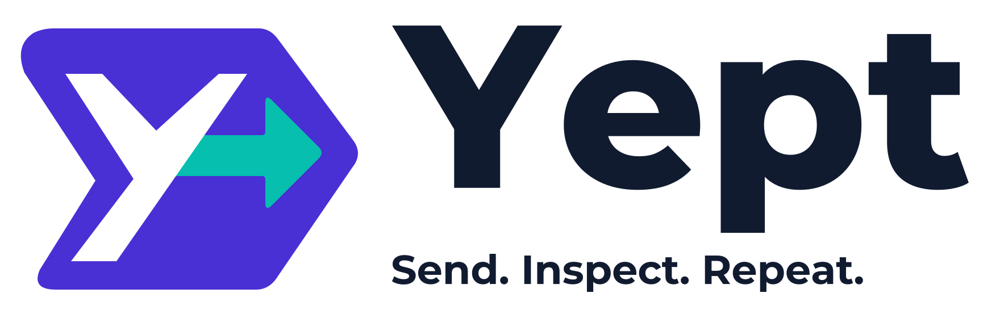
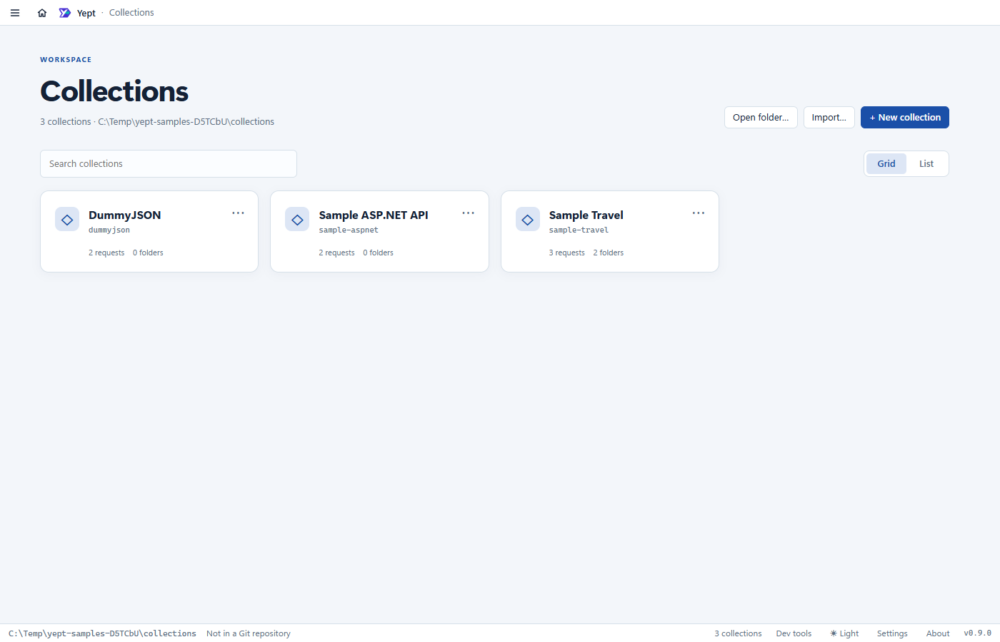
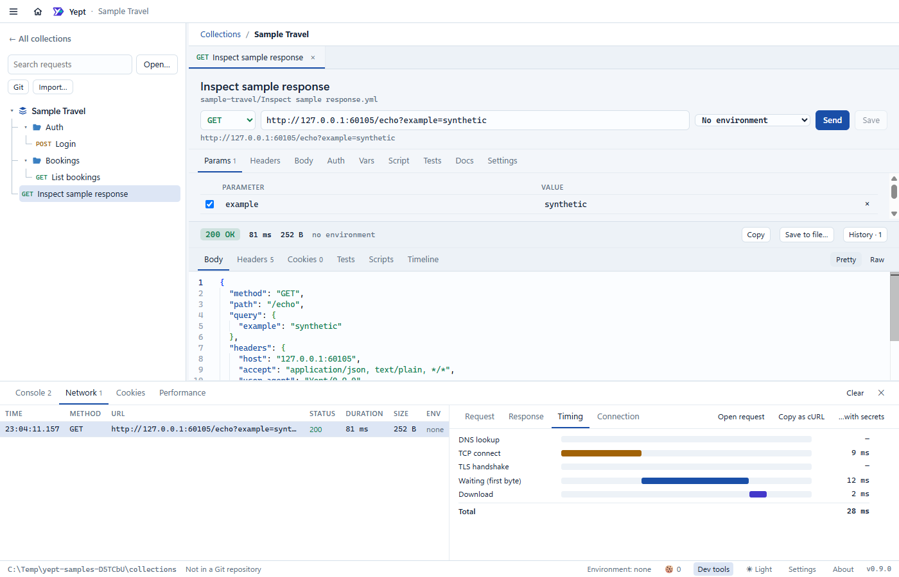

<h1>
  <picture>
    <source media="(prefers-color-scheme: dark)" srcset="docs/images/yept-logo-dark.svg">
    
  </picture>
</h1>

Yept is a local desktop API client for debugging HTTP integrations. Collections are plain Bruno OpenCollection YAML files that you review and share through Git. Request diagnostics and redacted response history help explain what happened between a request and its response.

The application is MIT licensed, needs no Yept account and has no telemetry. Collections stay in your folders; local secrets, cookies, history and personal settings stay in the app's user-data folder. Requests go to the APIs you choose, and Git operations use your configured remotes and credentials.

## What it does

- Edit requests with headers, query parameters, JSON, text, XML, URL-encoded forms and multipart file uploads.
- Use environments and encrypted local secrets; bearer, basic, API key, Digest, NTLM and AWS Signature v4 auth; and OAuth2 client credentials with token caching.
- Run pre/post-request scripts, assertions and a sequential collection runner. Unresolved variables block sending.
- Inspect redirect hops, sent headers, timings, TLS details, cookies, reconstructed raw HTTP and masked cURL exports in Dev tools.
- Keep response history with redaction before storage, and follow requests across renames.
- Review diffs, stage files, commit selected changes, push, fetch and pull with the desktop Git panel. A leak check flags common credential patterns.
- Import Postman, Insomnia, OpenAPI and Bruno files; export a bundled OpenCollection file. Paste a curl command to create a request.
- Choose light/dark mode, themes and installed fonts.





Screenshots use an isolated profile and synthetic fixtures. See the [user guide](docs/user-guide.md) for the interface and keyboard shortcuts.

## Downloads and platform status

This checkout is Yept 0.9.0. A public installer release is not available yet; the source-build steps below are the supported way to try this tree. When release assets are published, use this repository's **Releases** page and read the signing status attached to that version.

| Platform | Current status |
|---|---|
| Windows x64 | Primary development and test platform. Builds an NSIS installer. Current builds are unsigned. |
| macOS Apple Silicon / Intel | Experimental local DMG/ZIP builds, made on a Mac. No Apple Developer ID signature or notarization. |
| Linux | No desktop Linux package. |
| VS Code | Extension prepared for a pre-release on the Visual Studio Marketplace and Open VSX; see [Yept for VS Code](apps/vscode/README.md) and [extension development](apps/vscode/CONTRIBUTING.md). Not published yet. |

See the [code signing policy](docs/code-signing.md). A checksum verifies that a download matches a published file; it does not establish publisher identity. Do not disable operating-system protections to open an unexpected download.

## Build and run from source

Install [Node.js 24 LTS](https://nodejs.org/en/download) with npm, and [Git](https://git-scm.com/downloads). Node 24 is the development version used for these instructions. No native-module compiler is required. Use Windows for Windows packages and a Mac for macOS packages.

Copy the clone URL from this repository's **Code** menu. Replace `REPOSITORY_URL` below with that URL and authenticate if repository access is restricted. Run the commands in PowerShell, Terminal or another shell:

```sh
git clone REPOSITORY_URL yept
cd yept
npm ci
npx --no-install install-electron
npm run dev
```

Run npm commands from the repository root. `npm ci` installs the locked packages. Electron 43 no longer downloads its runtime during package installation, so `npx --no-install install-electron` explicitly installs the binary for this checkout's pinned version. Both steps need network access. Without the runtime, the development launcher can report `Electron uninstall`. See [Electron's installation instructions](https://www.electronjs.org/docs/latest/tutorial/installation).

The first development launch opens the collections home. Choose **Open folder** and select `fixtures/collections` inside your checkout to load the synthetic samples. Close the app and stop the development command with Ctrl+C when finished.

To send a local sample without an external API, start the fixture server in a second terminal at the repository root:

```sh
npm run fixture-server
```

In Yept, open **Sample Travel**, right-click its collection heading and choose **Environments…**. Select **local**, enter `sample-secret` in **Secret value for clientSecret**, press Enter, and click **Use this environment**. Close the dialog, open **Login**, and send it; then open and send **List bookings**. These credentials are only for the fixture server on `http://localhost:4010`; the returned token stays local. Stop the fixture server with Ctrl+C.

If your organisation intercepts TLS, use Node's system certificate support before installing or packaging:

```powershell
$env:NODE_USE_SYSTEM_CA = '1'
```

For macOS shells, use `export NODE_USE_SYSTEM_CA=1`. Keep certificate verification enabled.

## Check and package

If `dotnet` is absent, the ASP.NET sample checks skip. If it is installed, the suite expects the .NET 10 sample to be built and its development certificate trusted. Before the first E2E run, prepare it with:

```sh
dotnet build samples/SampleApi
dotnet dev-certs https --trust
```

The certificate command may ask for operating-system approval. Then run:

```sh
npm run typecheck
npm test
npm run check:licenses
npm run e2e
npm run package:win
```

The E2E command builds the app and uses Playwright with separate temporary profiles and synthetic collections. It does not use your collections or settings. Git is needed for its Git checks. OpenSSL enables optional TLS unit checks. Neither OpenSSL nor .NET is needed to build or launch Yept. See [testing](docs/testing.md) for details and failure screenshots.

The Windows installer is `dist/Yept-Setup-0.9.0.exe`; the unpacked executable is `dist/win-unpacked/Yept.exe`. From the repository root, run its packaging self-tests with:

```powershell
.\dist\win-unpacked\Yept.exe --self-test
```

On a Mac, replace the packaging command with `npm run package:mac`; DMG and ZIP files for arm64 and x64 appear in `dist/`. These builds remain experimental: follow [macOS build and test instructions](docs/macos-build.md), and do not treat a local signature as Apple notarization.

The [desktop validation workflow](.github/workflows/ci.yml) checks pull requests and changes to `main` on Windows and both Mac architectures. Windows also runs E2E and packaged-app checks. Manually approved version-tag builds retain packages as short-lived Actions artifacts; they do not publish a release. See [CI and tag-build instructions](docs/testing.md#github-actions) for triggers, diagnostics and approval requirements.

## Current limits

- HTTP request workflows only: no dedicated WebSocket, gRPC or MQTT client, CLI runner or cloud collaboration service.
- OAuth2 client credentials only; no authorization-code/PKCE, password/implicit flows or refresh-token flow.
- No Kerberos/Negotiate or proxy auth. AWS Signature v4 needs the access keys in the request: AWS profiles are not read.
- Collection runs are sequential, with no data files, iterations, schedules, parallel runs or report export.
- Bruno compatibility is limited to the supported file fields and script APIs. `.bru` collections open read-only and can be converted to YAML. Unsupported body types are retained when editing other fields but cannot be sent until changed to a supported type. `bru.runRequest` and multipart file sends through `bru.sendRequest` are unavailable.
- Scripts have a five-second execution limit. `bru.sendRequest` shares that limit and permits at most ten requests per script.
- The Git panel does not resolve merges, rebase, stash or force-push. Use your normal Git tool for those operations.
- Redaction and leak checks are safeguards, not a guarantee that arbitrary response data or unknown credentials are safe to publish. Review exports, logs and screenshots yourself.

See [architecture](docs/architecture.md) for exact behaviour and storage locations, and [security](SECURITY.md) for private reporting and trust boundaries.

## Choosing an API client

Local files and Git are not unique to Yept. Choose by the workflow you need; this is not a pricing or feature-parity claim. The linked upstream documentation was checked on 30 October 2026.

| Client | Workflow described by its documentation | How Yept compares |
|---|---|---|
| [Bruno](https://www.usebruno.com/opencollection) | OpenCollection uses Git-friendly files or a bundled YAML collection. | Yept uses Bruno's published packages and the same collection format, with its own desktop UI, runner, history and diagnostics. Check the compatibility limits above. |
| [Postman](https://learning.postman.com/docs/collaborating-in-postman/using-workspaces/create-workspaces/) | Workspaces support shared API work and can start from a Git repository. | Yept keeps collaboration in your existing Git repository and has no hosted workspace service. |
| [Insomnia](https://developer.konghq.com/insomnia/git-sync/) | Git Sync stores project resources in a repository and provides Git operations and merge handling in the app. | Yept also has a Git panel, but delegates merge resolution to your normal Git tool. Its files use OpenCollection rather than Insomnia's project format. |

## Repository and contributing

| Path | Contents |
|---|---|
| `packages/core` | Plain Node engine, shared model and API contract |
| `packages/ui` | Shared React components, editors, renderer state and styles |
| `apps/desktop` | Desktop services, Electron host adapter, preload and UI shell |
| `apps/vscode` | VS Code extension, bundled webview and extension-host checks |
| `fixtures`, `e2e`, `samples` | Synthetic collections, local API, automated UI checks and optional ASP.NET sample |
| `shims` | Local stand-in for `@usebruno/requests` |
| `docs` | User guide, architecture, testing and platform documentation |

The npm workspaces are `@yept/core`, `@yept/ui`, `@yept/desktop` and `yept-vscode`. Desktop builds write to `out/`; packages write to `dist/`. The extension's generated files stay inside `apps/vscode`.

Read [CONTRIBUTING](CONTRIBUTING.md) before sending a change and follow the [Code of Conduct](CODE_OF_CONDUCT.md). Report vulnerabilities privately using [SECURITY](SECURITY.md).

## Licence and Bruno attribution

Copyright (c) 2026 Selva Subramaniam. Yept is licensed under [MIT](LICENSE).

Yept builds on [Bruno](https://github.com/usebruno/bruno)'s MIT-licensed `@usebruno/filestore`, `@usebruno/js`, `@usebruno/common` and `@usebruno/converters` packages. It has its own application shell and request pipeline; it is not the Bruno application. Bruno is a trademark of its owners, and this project is not affiliated with Bruno.

Dependencies retain their own licences and copyright notices. `npm run notices` generates the bundled notices shown in **About**; `npm run check:licenses` regenerates and verifies them offline. See [licence sources](build/licenses/README.md).
