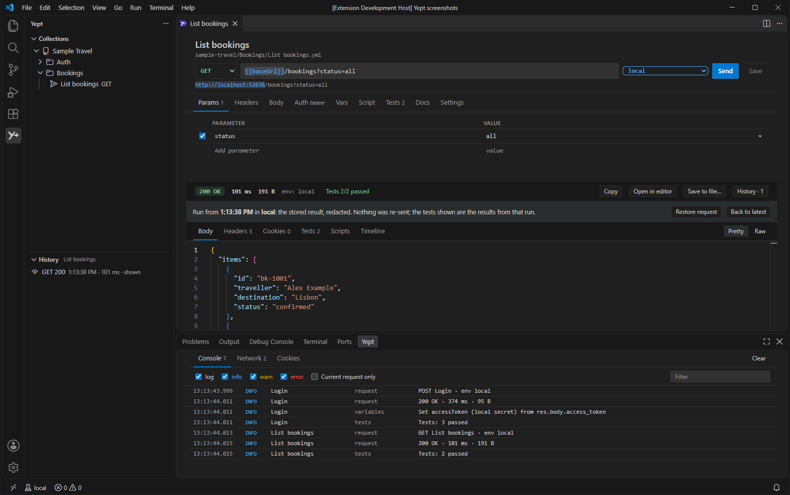
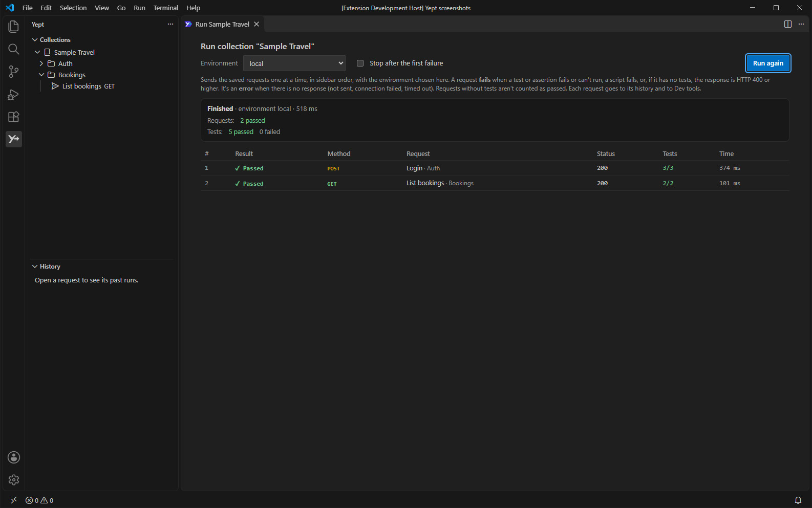
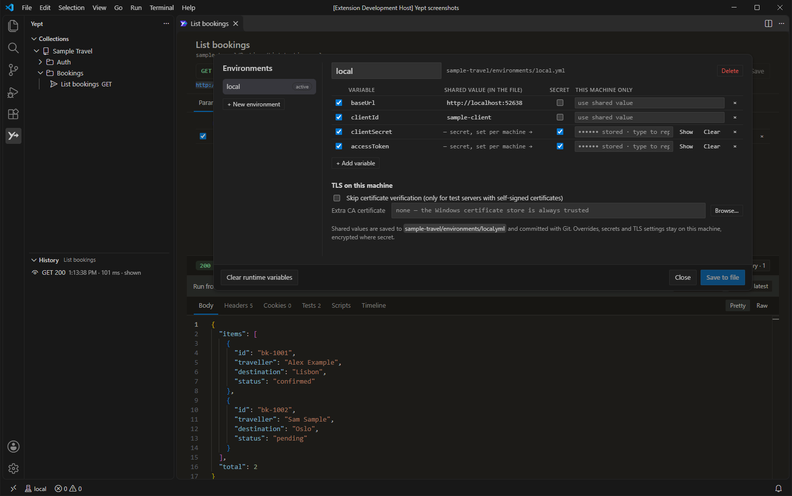

# Yept for VS Code

**Send. Inspect. Repeat.** Yept is a local API client for debugging HTTP integrations. Your collections are plain Bruno OpenCollection YAML files in your repository, so you review and share them through Git like any other code. Secrets, cookies and response history stay on your machine.

This extension brings the Yept desktop app's request editor, response pane, collection runner and Dev Tools into VS Code. It reads and writes the same files, so you can use both on the same collections.

> **Pre-release.** Yept for VS Code is in preview. It has been tested on Windows. Please [report problems](https://github.com/selva-ts/yept/issues).

## Features

- **Collections tree.** The **Yept** activity-bar view finds every collection in your workspace folders. You can create, rename, duplicate and delete requests and folders, and move them by dragging within a collection. Deleted items go to the system trash. Bruno `.bru` collections open read-only.
- **Request panels.** Each request opens in its own editor tab. You can edit the method, URL, parameters, headers, body (JSON, text, XML, forms and multipart), auth, variables, scripts, tests and docs. Send it, then inspect the status, headers, cookies, timeline and a formatted body. **Ctrl+S** (**Cmd+S**) saves. A tab with unsaved changes shows `●`. **Open in editor** shows a large body in a read-only VS Code editor.
- **Environments.** The status bar shows the active environment. Click it to switch. **Manage Environments** edits the environments: shared values are saved to the collection's `environments/*.yml`; overrides, secrets and TLS settings stay on this machine.
- **History.** Each send is kept locally, with secrets redacted. The **History** view lists past runs of the request you are working on. Open a run to see its request and response, or restore it into the editor.
- **Response tools.** Filter a JSON body with JSONPath, save a value as a runtime variable or a local secret, save the body to a file exactly as received, and preview images and PDFs without scripts or network. In the request panel's history, **Compare** shows two stored runs side by side.
- **Collection runner.** **Run Collection** and **Run Folder** send the saved requests in order, with the environment you choose, and show each result, its tests and timings as they arrive.
- **Dev Tools.** A **Yept** view in the bottom panel has Console, Network and Cookies tabs for every send from request panels and the runner. Network copies a request as cURL, C#, PowerShell, JavaScript (`fetch` or axios) or Python, with secrets masked unless you tick *Include secrets and cookies*.
- **Import and export.** Import Postman, Insomnia, OpenAPI or bundled OpenCollection files, or a Bruno `.bru` collection folder. You see a preview before anything is written, and credentials found in the import can become secret variables. Export writes one OpenCollection YAML file, never with secret values.
- **Paste cURL.** Turn a curl command on the clipboard (bash or Windows cmd) into a new request. Nothing is sent until you choose.
- **Leak check.** Credentials written into collection files show as warnings in the **Problems** panel, without the value. An optional Git pre-commit hook blocks commits that would leak a secret, from any Git client.
- **Scripts and tests.** Pre-request and post-response scripts, assertions and tests run in a QuickJS sandbox, as in the desktop app.

## Quick start

1. Open a folder in VS Code. It can be an empty folder or a repository that already has collections.
2. Select the **Yept** icon in the activity bar.
3. Choose **New Collection**, **Open Collection** or **Import Collection**. A Yept collection is a folder with an `opencollection.yml` file.
4. Choose **+** on the collection to add a request, or run **Yept: Paste cURL** with a curl command on the clipboard.
5. Pick an environment in the status bar if the collection has one, then select **Send** (**Ctrl+Enter**).

Commit the collection folder with Git as usual. Keep secret values out of the files: use a `{{variable}}`, mark it secret in **Manage Environments** and enter its value there. The value is stored encrypted on this machine only.

## Commands

Run these from the Command Palette (**Ctrl+Shift+P** / **Cmd+Shift+P**). Most of them are also on the Collections view's toolbar or context menus.

| Command | What it does |
|---|---|
| **Yept: Open Request** | Choose a request by collection and path, and open it. |
| **Yept: New Request** / **New Collection** | Create a request or a collection. |
| **Yept: Open Collection** | Add an existing collection folder to the workspace. |
| **Yept: Import Collection** / **Export Collection** | Import from Postman, Insomnia, OpenAPI, OpenCollection or Bruno; export to OpenCollection YAML. |
| **Yept: Paste cURL** | Create a request from a curl command on the clipboard. |
| **Yept: Select Environment** / **Manage Environments** | Switch or edit a collection's environments. |
| **Yept: Run Collection** | Run a collection's saved requests in order. |
| **Yept: Show Dev Tools** | Show the Console, Network and Cookies view. |
| **Yept: Check for Leaked Secrets** | Scan the workspace's collections now. |
| **Yept: Install Pre-commit Leak Check Hook** / **Remove…** | Add or remove the leak check in a repository's pre-commit hook. |
| **Yept: Run Diagnostics** | Check the local database, certificates, script sandbox and editor workers. |

In the Collections view, **F2** renames and **Delete** (**Cmd+Backspace**) deletes the selected item.

## Settings

| Setting | Default | Description |
|---|---|---|
| `yept.cookies.automatic` | `true` | Keep cookies from responses and send them with later requests to the same site, per collection and environment. Stored encrypted on this machine. |
| `yept.history.runsPerRequest` | `20` | Responses kept in history for each request (1–500). |
| `yept.history.maxSizeMb` | `500` | Total size of the response history, in MB. The oldest entries go first. |
| `yept.history.bodyLimitMb` | `2` | Largest response body kept in history, in MB. Larger bodies are recorded without their content. `0` keeps no bodies. |

Settings apply without a reload.

## Privacy and security

- **Local-first.** Yept has no account and no telemetry. Requests go only to the URLs you send them to. The request pages make no network requests of their own.
- **Your files.** Collections are the YAML files in your folders. Yept changes them only when you save, create, rename, move, import or delete.
- **Secrets.** Secret values, local overrides, cookies and TLS settings are kept in VS Code's storage for the extension. They are encrypted with AES-256-GCM, under a key held in VS Code's secret storage (your operating system's keychain). They are never written to collection files or exports. If the keychain can't be reached, secrets and automatic cookies are unavailable, and the rest still works.
- **History** is stored locally, with secret values redacted before storage.
- **Workspace Trust.** In folders you haven't trusted, requests still send, but scripts, post-response variables, assertions and tests don't run. They are reported as not run until you trust the folder. The leak check, which only reads files, runs in untrusted folders too. Installing or removing the pre-commit hook runs Git, so it needs a trusted folder.
- The desktop app keeps its own secrets with its own key, so you enter secrets separately in each.

## Limits

- **Remote windows** (WSL, SSH, Dev Containers, Codespaces) and virtual workspaces aren't supported yet. Open the folder in a local VS Code window.
- Git is left to VS Code's Source Control. Yept adds only the leak check and the optional hook.
- Dev Tools has no Performance tab; that tab is only in the desktop app.
- The request pages follow VS Code's light, dark and high-contrast colours, but not the syntax colours of custom themes.
- Bruno compatibility is limited to the supported file fields and script APIs. `.bru` collections are read-only. Import one to convert it to YAML.
- Tested on Windows. macOS and Linux builds use the same code, but haven't been tested yet.
- Needs VS Code 1.101 or later. It also runs in editors built on VS Code, such as VSCodium and Cursor, when they are based on 1.101 or later.

## Links

- [Source code](https://github.com/selva-ts/yept) · [Issues](https://github.com/selva-ts/yept/issues) · [Changelog](https://github.com/selva-ts/yept/blob/main/apps/vscode/CHANGELOG.md)
- [Yept user guide](https://github.com/selva-ts/yept/blob/main/docs/user-guide.md) (desktop app)
- [Extension development](https://github.com/selva-ts/yept/blob/main/apps/vscode/CONTRIBUTING.md)

Yept is MIT licensed. It builds on [Bruno](https://github.com/usebruno/bruno)'s MIT-licensed packages and the OpenCollection format. It is not the Bruno application and isn't affiliated with Bruno. Third-party notices are included in the extension.
